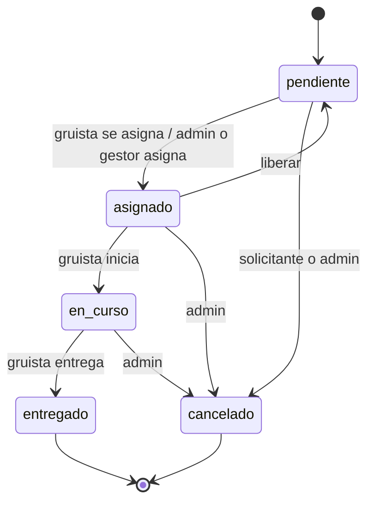

# Tow Transfer

_Gestión de traslados en grúa entre centros._

Aplicación web interna para gestionar las solicitudes de traslado de vehículos entre los distintos centros de trabajo de un grupo de concesionarios. Sustituye el flujo actual (correo electrónico + Excel) por un sistema con roles, estados e historial.

> **Estado del proyecto:** en planificación (Paso 10 de 16).
> Proyecto de estudio / portfolio, con posibilidad de uso real en la empresa.

---

## 1. Descripción

- Entre 10 y 20 concesionarios, 2-3 gruistas y más de 40 solicitantes.
- Los gruistas usan la app sobre todo desde el **móvil**; solicitantes, gestores y administradores desde ordenador.
- Uso interno: sin registro público, las cuentas las crea el administrador.
- Sin notificaciones en la primera versión: basta con consultar el estado en la web.

## 2. Roles

| Rol               | Descripción                                                                  |
| ----------------- | ---------------------------------------------------------------------------- |
| **Solicitante**   | Pertenece a un concesionario. Solicita traslados y consulta su estado.       |
| **Gruista**       | Se asigna traslados disponibles y fija fecha y hora según su disponibilidad. |
| **Gestor**        | Supervisa y organiza los traslados. No gestiona usuarios ni cancela.         |
| **Administrador** | Todos los permisos, incluida la gestión de usuarios y centros.               |

### Matriz de permisos

| Acción                                   | Solicitante                    | Gruista                | Gestor | Admin                  |
| ---------------------------------------- | ------------------------------ | ---------------------- | ------ | ---------------------- |
| Crear traslado                           | ✅                             | ❌                     | ✅     | ✅                     |
| Ver traslados                            | Solo los suyos                 | Pendientes + los suyos | Todos  | Todos                  |
| Editar datos del traslado                | Los suyos, solo si `pendiente` | ❌                     | ✅     | ✅                     |
| Cancelar                                 | Los suyos, solo si `pendiente` | ❌                     | ❌     | ✅ en cualquier estado |
| Autoasignarse y fijar fecha/hora         | ❌                             | ✅                     | ❌     | ❌                     |
| Asignar o reasignar gruista y fecha/hora | ❌                             | ❌                     | ✅     | ✅                     |
| Liberar un traslado (solo en `asignado`) | ❌                             | ✅ (los suyos)         | ✅     | ✅                     |
| Pasar a `en curso` y `entregado`         | ❌                             | ✅ (los suyos)         | ❌     | ✅                     |
| Gestionar centros (lista fija)           | ❌                             | ❌                     | ❌     | ✅                     |
| Alta, baja y desactivación de usuarios   | ❌                             | ❌                     | ❌     | ✅                     |

## 3. Traslados

Un traslado corresponde a **un vehículo**.

| Campo                 | Notas                                    |
| --------------------- | ---------------------------------------- |
| Matrícula / chasis    | Al menos uno de los dos                  |
| Marca y modelo        |                                          |
| Centro de recogida    | De la lista fija de centros              |
| Centro de entrega     | De la lista fija de centros              |
| Fecha y hora deseada  | Propuesta del solicitante, no vinculante |
| Fecha y hora asignada | La fija el gruista (o admin/gestor)      |
| Urgencia              | `baja`, `normal`, `alta`, `urgente`      |
| Estado                | Ver ciclo de vida                        |
| Observaciones         | Texto libre                              |

### Ciclo de vida

Estados: `pendiente`, `asignado`, `en curso`, `entregado`, `cancelado`.



Cada cambio de estado se registrará en un **historial** (quién, cuándo, de qué estado a cuál).

## 4. Modelo de datos

Cuatro tablas: `centers`, `users`, `transfers` y `transfer_status_history`.

| Tabla                     | Campos principales                                                                                                                                                         |
| ------------------------- | -------------------------------------------------------------------------------------------------------------------------------------------------------------------------- |
| `centers`                 | id, name (único), address, active                                                                                                                                          |
| `users`                   | id, name, email (único), password_hash, role, center_id, active, created_at                                                                                                |
| `transfers`               | id, plate, vin, brand, model, origin_center_id, destination_center_id, requested_at, scheduled_at, urgency, status, notes, requester_id, driver_id, created_at, updated_at |
| `transfer_status_history` | id, transfer_id, status, changed_by, changed_at                                                                                                                            |

Relaciones: un centro tiene muchos usuarios; un centro es origen o destino de muchos traslados; un usuario es solicitante o gruista de muchos traslados; un traslado tiene muchas entradas de historial.

Reglas de integridad:

- Debe haber matrícula o chasis.
- Origen y destino no pueden ser el mismo centro.
- No puede haber dos traslados activos (`pendiente`, `asignado`, `en curso`) para la misma matrícula o chasis.
- `centers.active` y `users.active` permiten desactivar sin borrar.
- El campo `status` de `transfers` guarda el estado **actual**; `transfer_status_history` guarda **cada cambio** (quién y cuándo), lo que dará el historial futuro.

## 5. Tecnologías

> Stack confirmado en el Paso 3. Desarrollo sobre Linux (Manjaro).

| Capa          | Tecnología                                                                                                                                                                    |
| ------------- | ----------------------------------------------------------------------------------------------------------------------------------------------------------------------------- |
| Frontend      | Vite + React + TypeScript + React Router, TanStack Query (datos del servidor), React Hook Form + Zod (formularios) y Tailwind CSS (estilos); diseño responsive, móvil primero |
| Backend       | Node.js + Express + TypeScript                                                                                                                                                |
| Base de datos | PostgreSQL con Prisma                                                                                                                                                         |
| Autenticación | Email y contraseña (bcryptjs) + JWT firmado con `jose`, guardado en cookie `httpOnly`; control de roles en el servidor                                                        |
| Validación    | Zod                                                                                                                                                                           |
| Pruebas       | Vitest                                                                                                                                                                        |
| Contenedores  | Docker                                                                                                                                                                        |

## 6. Despliegue

_Por definir (Paso 14)._

- **Fase de prueba:** alojamiento gratuito en la nube.
- **Fase futura:** servidor propio de la empresa, mediante Docker.

## 7. Instalación en local

Requisitos: Node.js, Git y Docker con el plugin Compose (`docker compose`).

```bash
# 1. Base de datos (PostgreSQL en Docker), desde la raíz del proyecto
docker compose up -d

# 2. Backend
cd backend
cp .env.example .env   # then set JWT_SECRET (e.g. openssl rand -base64 48)
npm install
npx prisma migrate dev   # creates the tables and generates the Prisma client
npx prisma db seed       # optional: sample data for development only
npm run dev        # http://localhost:3000/api/health

# 3. Frontend (en otra terminal)
cd frontend
npm install
npm run dev        # http://localhost:5173
```

Linter: `npm run lint` en `backend` y en `frontend`.

Datos de prueba (solo desarrollo): usuarios `admin@example.com`, `manager@example.com`, `driver1@example.com`, `driver2@example.com` y `requester@example.com`, todos con la contraseña `Dev1234!`.

## 8. Registro de pasos

| Nº  | Paso                                                          | Estado                                           |
| --- | ------------------------------------------------------------- | ------------------------------------------------ |
| 1   | Definir requisitos y alcance del MVP                          | ✅ Completado                                    |
| 2   | Definir roles, permisos y estados                             | ✅ Completado                                    |
| 3   | Elegir stack tecnológico                                      | ✅ Completado                                    |
| 4   | Diseñar modelo de datos                                       | ✅ Completado                                    |
| 5   | Bocetar pantallas                                             | ✅ Completado                                    |
| 6   | Preparar entorno (Node, Git, Vite + React + TS)               | ✅ Completado                                    |
| 7   | Configurar backend y base de datos                            | ✅ Completado                                    |
| 8   | Autenticación y roles, gestión de usuarios y API de traslados | ✅ Completado                                    |
| 9   | Pantallas del solicitante                                     | ✅ Completado                                    |
| 10  | Pantallas del administrador y gestor                          | 🔄 En curso (10.1 hecho; 10.2 a 10.4 pendientes) |
| 11  | Pantallas del gruista                                         | ⏳                                               |
| 12  | Validaciones, errores y estados de carga                      | ⏳                                               |
| 13  | Pruebas                                                       | ⏳                                               |
| 14  | Despliegue                                                    | ⏳                                               |
| 15  | Documentación final                                           | ⏳                                               |
| 16  | Feedback y versión 2                                          | ⏳                                               |

## 9. Decisiones tomadas

| Decisión                                                                                                                                                                                                                                            | Motivo                                                                                                                           |
| --------------------------------------------------------------------------------------------------------------------------------------------------------------------------------------------------------------------------------------------------- | -------------------------------------------------------------------------------------------------------------------------------- |
| Nombre de la aplicación: **Tow Transfer** (repositorio `tow-transfer`)                                                                                                                                                                              | Corto, en inglés y fácil de recordar                                                                                             |
| Cuatro roles (solicitante, gruista, gestor, admin)                                                                                                                                                                                                  | Separar la supervisión diaria de la administración de usuarios                                                                   |
| El gruista se autoasigna los traslados                                                                                                                                                                                                              | Es quien conoce su disponibilidad                                                                                                |
| El gruista puede liberar un traslado, no cancelarlo                                                                                                                                                                                                 | La cancelación la decide el solicitante (si está `pendiente`) o el admin                                                         |
| El solicitante solo edita o cancela en `pendiente`                                                                                                                                                                                                  | Una vez agendado, no puede alterar la planificación del gruista                                                                  |
| Lista fija de centros gestionada por el admin                                                                                                                                                                                                       | Evita datos inconsistentes                                                                                                       |
| Los usuarios se desactivan, no se borran                                                                                                                                                                                                            | Conservar el historial de traslados                                                                                              |
| Los centros no guardan marca                                                                                                                                                                                                                        | No se limitarán los traslados por marca                                                                                          |
| Se evitan traslados activos duplicados por matrícula o chasis                                                                                                                                                                                       | Evitar solicitudes repetidas por error                                                                                           |
| Los gruistas atienden cualquier centro                                                                                                                                                                                                              | Solo hay 2-3 gruistas                                                                                                            |
| Tabla de historial de estados, además del estado actual                                                                                                                                                                                             | Saber quién cambió qué y cuándo; base del historial futuro                                                                       |
| Estilos con Tailwind CSS; adaptar los colores a la imagen corporativa queda para más adelante                                                                                                                                                       | Herramienta que ya conoce el autor; el tema se podrá ajustar con `@theme` si hace falta                                          |
| TanStack Query para las peticiones y React Hook Form con Zod para los formularios                                                                                                                                                                   | Menos código repetitivo (cargas, errores, caché) y validación con el mismo estilo que el backend                                 |
| En desarrollo el frontend llama a `/api` y Vite redirige las llamadas al backend (proxy)                                                                                                                                                            | Mismo origen para el navegador: las cookies de sesión funcionan sin ajustes especiales                                           |
| Textos de estados, urgencias y roles traducidos a español en un único archivo del frontend                                                                                                                                                          | Código en inglés e interfaz en español                                                                                           |
| Pantallas de login, detalle de traslado y centros sin boceto previo                                                                                                                                                                                 | Se diseñarán al programarlas, reutilizando el estilo de las demás                                                                |
| Sin notificaciones ni comprobante de entrega en la v1                                                                                                                                                                                               | Mantener el MVP sencillo                                                                                                         |
| ESLint como linter (en lugar de Oxlint)                                                                                                                                                                                                             | Estándar, muy documentado y con el ecosistema de plugins más completo; el tamaño del proyecto no requiere la velocidad de Oxlint |
| TypeScript fijado en la versión 6.0 (`~6.0.3`) en el backend                                                                                                                                                                                        | typescript-eslint aún no soporta TypeScript 7; se actualizará cuando lo haga                                                     |
| PostgreSQL en Docker durante el desarrollo                                                                                                                                                                                                          | Instalación idéntica en cualquier equipo y fácil de reproducir en el servidor de la empresa                                      |
| Repositorio en GitHub; una rama por paso o feature integrada en `main` con Pull Request                                                                                                                                                             | Mantener `main` estable, tener un historial ordenado y practicar un flujo de trabajo profesional                                 |
| Código, ramas, commits y Pull Requests en inglés; interfaz en español                                                                                                                                                                               | Seguir la convención habitual del código y mantener la aplicación en el idioma de los usuarios                                   |
| Prisma 7 con el adaptador `pg` para acceder a PostgreSQL; roles, estados y urgencias en inglés en el código (`REQUESTER`, `DRIVER`, `MANAGER`, `ADMIN`; `PENDING`, `ASSIGNED`, `IN_PROGRESS`, `DELIVERED`, `CANCELLED`) y traducidos en la interfaz | Seguir la regla de código en inglés y mostrar la interfaz en español                                                             |
| `tsconfig` estricto (`nodenext`, `exactOptionalPropertyTypes`, `noUncheckedIndexedAccess`) y comprobación con `tsc --noEmit`                                                                                                                        | Detectar errores de tipos antes de ejecutar; los imports relativos llevan extensión `.js`                                        |
| Sesión con JWT en cookie `httpOnly` (SameSite=Lax), 8 horas de duración y sin refresh token en la v1                                                                                                                                                | Evitar que scripts del navegador lean el token; una sesión equivale a una jornada de trabajo                                     |
| El admin crea las cuentas con una contraseña inicial y cada usuario puede cambiarla después                                                                                                                                                         | Cuentas controladas por el admin sin que este conozca la contraseña definitiva                                                   |
| Variables de entorno validadas con Zod al arrancar (`config.ts`)                                                                                                                                                                                    | Fallar pronto y con un mensaje claro si falta algo, por ejemplo `JWT_SECRET`                                                     |
| Reglas de permisos centralizadas en `permissions.ts`, comprobadas con pruebas automáticas                                                                                                                                                           | Un único sitio donde cambiar la matriz de permisos y garantía de que no se rompe                                                 |
| El admin puede cancelar traslados pendientes, asignados o en curso, pero no los ya entregados o cancelados                                                                                                                                          | Cancelar algo ya entregado no tiene sentido                                                                                      |
| Gestor y admin solo editan los datos de un traslado mientras está pendiente o asignado                                                                                                                                                              | Una vez en curso, los datos quedan fijos                                                                                         |
| Los 401 indican "sin sesión" y los 403 "rol sin permiso"                                                                                                                                                                                            | Permite al frontend distinguir cerrar sesión de mostrar un aviso                                                                 |
| Las respuestas de traslados incluyen `allowedActions`, calculadas en el servidor con las reglas de `permissions.ts`                                                                                                                                 | El frontend sabe qué botones mostrar sin duplicar las reglas de permisos                                                         |
| Un traslado que el usuario no puede ver responde 404, no 403                                                                                                                                                                                        | No revelar que existe                                                                                                            |
| Matrículas y chasis se normalizan al guardar (sin espacios ni guiones, en mayúsculas)                                                                                                                                                               | Detectar duplicados aunque se escriban de formas distintas                                                                       |
| Cada acción sobre un traslado es un endpoint propio (`assign`, `schedule`, `release`, `start`, `deliver`, `cancel`)                                                                                                                                 | Rutas claras y permisos fáciles de comprobar                                                                                     |
| Los cambios de estado comprueban el estado esperado en la propia actualización y se guardan junto a su historial en una transacción                                                                                                                 | Evitar que dos usuarios pisen el mismo traslado (por ejemplo, dos gruistas asignándoselo a la vez)                               |
| La fecha asignada debe ser futura; el gruista asignado puede reprogramarla                                                                                                                                                                          | El gruista tiene la última palabra sobre la fecha                                                                                |
| Un único formulario de traslado para crear y editar, con su esquema de validación en `lib/transferForm.ts`                                                                                                                                          | Evitar duplicar campos y reglas                                                                                                  |
| Las acciones del detalle de un traslado (asignar, reprogramar, liberar, iniciar, entregar, cancelar) se muestran según `allowedActions`, para todos los roles                                                                                       | Un único panel de acciones para gestor, admin y gruista, sin repetir reglas de permisos en el frontend                           |
| Tras cualquier acción, haya ido bien o mal, se recargan los traslados                                                                                                                                                                               | Mostrar siempre el estado real si alguien más lo cambió a la vez                                                                 |
| Backend propio en lugar de servicio gestionado                                                                                                                                                                                                      | Objetivo de aprendizaje                                                                                                          |
| Docker para el despliegue                                                                                                                                                                                                                           | Facilitar el paso posterior a un servidor de la empresa                                                                          |
| Stack: React + TS, Node/Express, PostgreSQL + Prisma, JWT, Zod                                                                                                                                                                                      | Encaja con el objetivo de aprender backend, con tipado de extremo a extremo                                                      |

## 10. Flujo de trabajo con Git

- **`main`** contiene siempre una versión que funciona.
- Cada paso del plan o feature se desarrolla en **su propia rama**, con nombre `tipo/descripcion-corta` (por ejemplo `feat/step-07-prisma-schema`). Tipos: `feat`, `fix`, `docs`, `chore`, `refactor`, `test`.
- Los commits son pequeños y siguen el formato `tipo: descripción` (por ejemplo `feat: add Prisma schema`).
- **Idioma:** código, nombres de ramas, mensajes de commit y Pull Requests en inglés; la interfaz de la aplicación en español.
- La rama se integra en `main` mediante **Pull Request** (squash and merge) y después se borra.

```bash
git switch main && git pull
git switch -c feat/nombre-de-la-rama
# ... trabajar y hacer commits ...
git push -u origin feat/nombre-de-la-rama
# abrir Pull Request en GitHub, fusionar y borrar la rama
git switch main && git pull
git branch -d feat/nombre-de-la-rama
```

## 11. API

Todas las rutas, salvo el login y `health`, requieren sesión (cookie `httpOnly`).

| Ruta                                                            | Quién                           | Descripción                                                                                                            |
| --------------------------------------------------------------- | ------------------------------- | ---------------------------------------------------------------------------------------------------------------------- |
| `GET /api/health`                                               | Público                         | Comprobación de estado                                                                                                 |
| `POST /api/auth/login`, `POST /api/auth/logout`                 | Público / sesión                | Inicio y cierre de sesión                                                                                              |
| `GET /api/auth/me`                                              | Sesión                          | Usuario actual                                                                                                         |
| `POST /api/auth/change-password`                                | Sesión                          | Cambio de contraseña propia                                                                                            |
| `GET /api/centers`                                              | Sesión                          | Centros activos (el admin puede añadir `?includeInactive=true`)                                                        |
| `POST /api/centers`, `PATCH /api/centers/:id`                   | Admin                           | Alta y edición de centros                                                                                              |
| `GET /api/drivers`                                              | Admin, gestor                   | Gruistas activos (para asignar y filtrar)                                                                              |
| `GET /api/users`, `POST /api/users`, `PATCH /api/users/:id`     | Admin                           | Gestión de usuarios (alta, edición, desactivación y contraseña)                                                        |
| `POST /api/transfers`                                           | Solicitante, gestor, admin      | Crear traslado                                                                                                         |
| `GET /api/transfers`                                            | Sesión                          | Listado según el rol, con filtros (`status`, `urgency`, `centerId`, `driverId`, `q`) y paginación (`page`, `pageSize`) |
| `GET /api/transfers/:id`                                        | Sesión                          | Detalle con historial                                                                                                  |
| `PATCH /api/transfers/:id`                                      | Según permisos                  | Editar datos                                                                                                           |
| `POST /api/transfers/:id/assign`                                | Gruista, gestor, admin          | Asignar gruista y fecha                                                                                                |
| `PATCH /api/transfers/:id/schedule`                             | Gruista asignado, gestor, admin | Cambiar la fecha asignada                                                                                              |
| `POST /api/transfers/:id/release`, `start`, `deliver`, `cancel` | Según permisos                  | Liberar, iniciar, entregar y cancelar                                                                                  |

Cada traslado devuelto incluye `allowedActions`, con lo que el usuario actual puede hacer sobre él.

## 12. Roadmap (versiones futuras)

- Seguimiento GPS en tiempo real
- Calendario de disponibilidad de grúas
- Historial y consulta de traslados pasados
- Posibles ideas posteriores: notificaciones, informes y estadísticas
